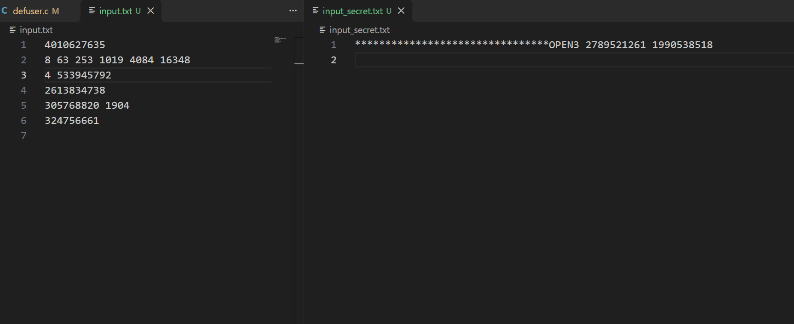
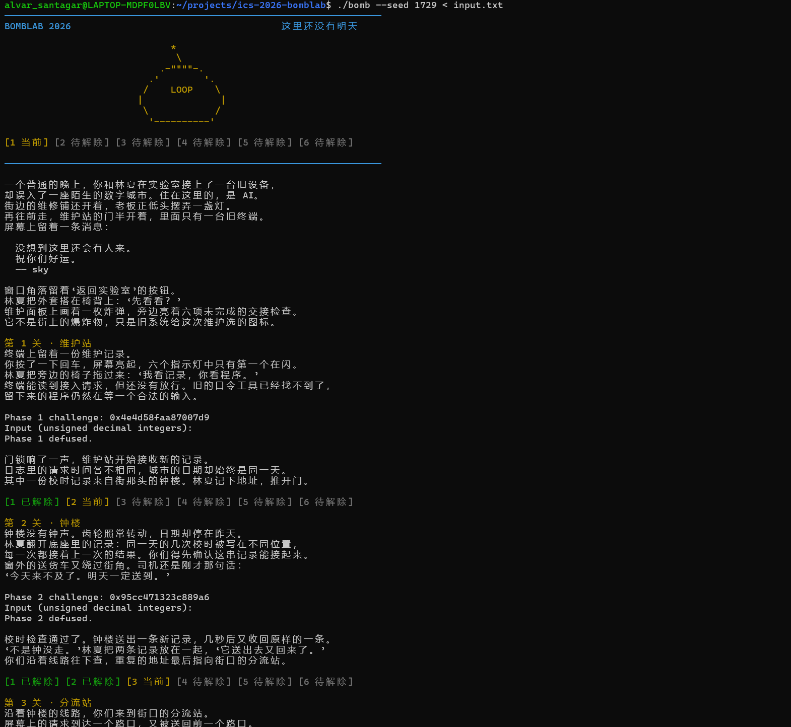
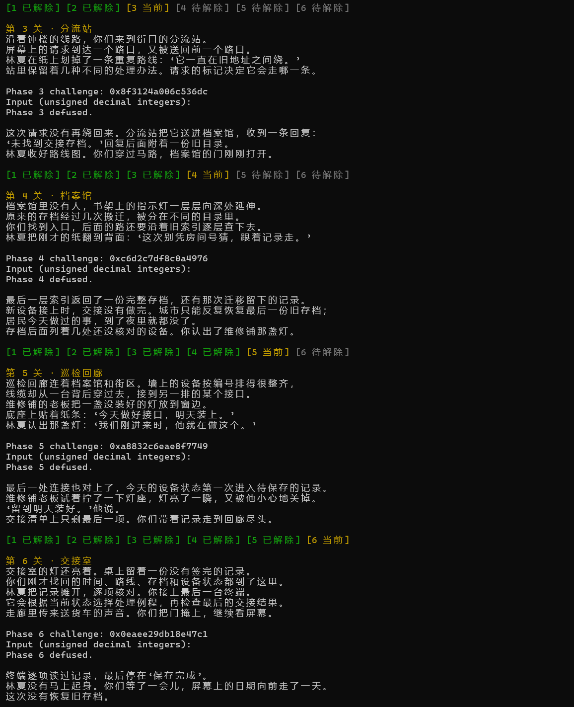
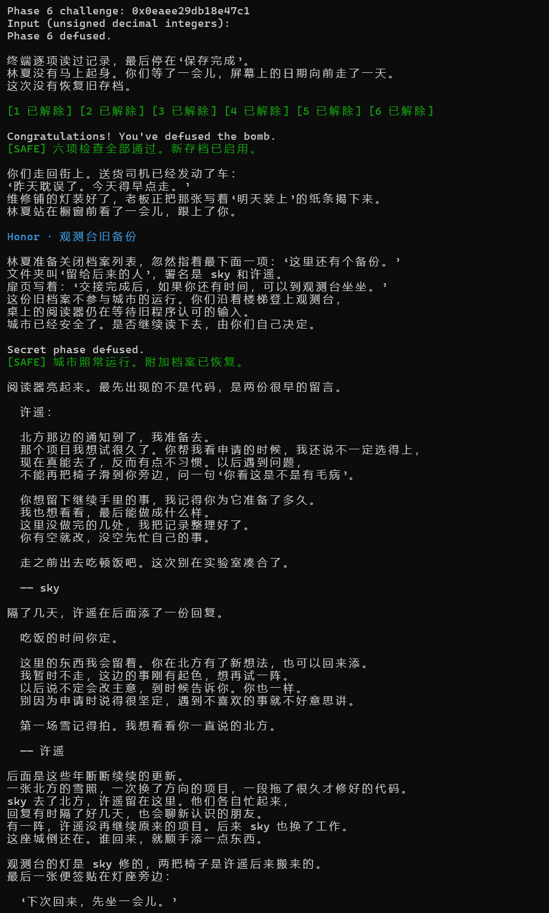
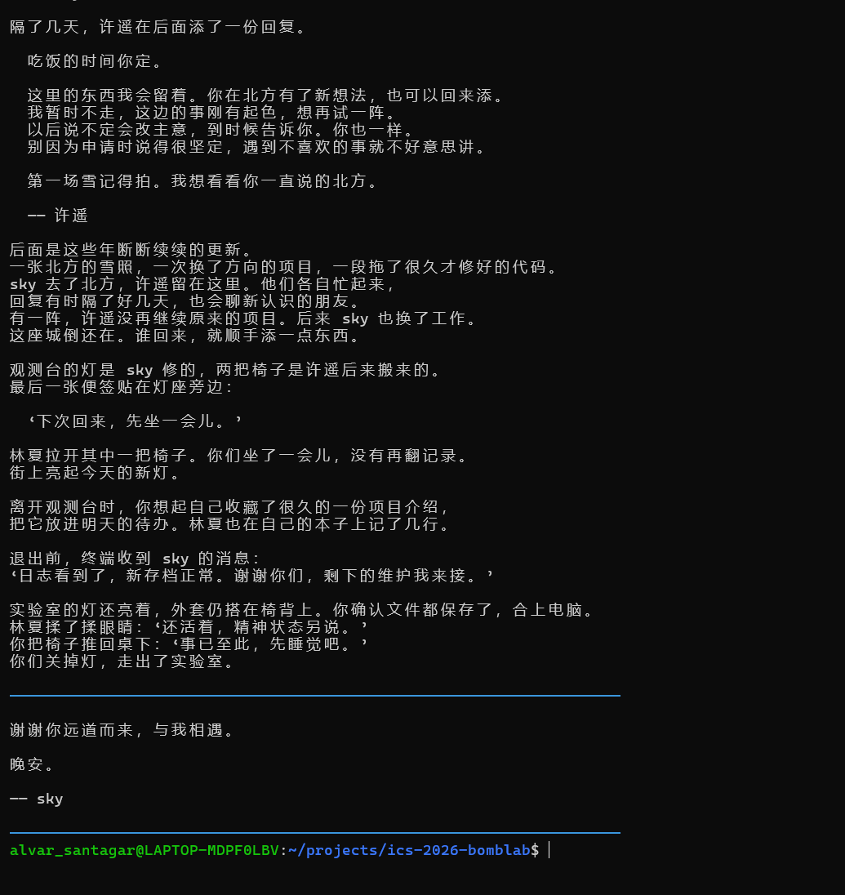

# Lab2：BombLab 实验报告

## 1. 实验目标与分析方法

本实验要求根据个人炸弹的反汇编，实现从 `challenge` 到各关口令的计算，而不是记录某一次运行的固定答案。Honor（Secret）还需要使用驱动传入的 `context`，构造完整的第七行文本。本文根据我已经编写的 `defuser.c` 及其中的分析注释，结合对应的 `bomb.S`，整理六个正式关卡与 Secret 的解题思路。

我的主要方法是先观察各关调用 `valid_u32_fields`、`sscanf` 的部分，确认口令中整数的数量和存放位置，再从比较指令反向追踪期望值的来源。对于较长的运算，我先用与寄存器同名的变量逐步转写；识别出循环、分支或递归结构后，再整理成 C 代码。

| 关卡 | 输出内容 | 核心分析对象 |
| --- | --- | --- |
| Phase 01 | 1 个无符号整数 | 三个辅助函数的参数与返回值 |
| Phase 02 | 6 个无符号整数 | 数组访问及递推循环 |
| Phase 03 | 2 个无符号整数 | 跳转表与分支映射 |
| Phase 04 | 1 个无符号整数 | 二分递归及回溯计算 |
| Phase 05 | 2 个无符号整数 | 结构体、链表及指针输出参数 |
| Phase 06 | 1 个无符号整数 | 函数指针表及两次间接调用 |
| Secret / Honor | 填充字符、`OPEN` 和 3 个无符号整数 | 栈内偏移、字符串复制及位运算 |

下面用 `C` 表示 64 位无符号数 `challenge`，用 `K` 表示 `context`；`u32(x)` 表示只保留 `x` 的低 32 位。除特别说明外，32 位结果的加法、乘法和左移均保留低 32 位，右移按无符号逻辑右移理解。异或用 `^` 表示。

本文整理了代码中的七关实现，并在第 9 节附上非公开 seed `1729` 下六个正式关卡与 Secret 全部通过的运行记录和截图。

## 2. Phase 01：跟踪函数调用与返回值

`phase_01` 要求输入一个整数，并在 `0x4020db` 调用 `p1_compute`，随后将其返回值 `%eax` 与输入比较。因此只需恢复 `p1_compute(challenge)` 的计算过程。

关键汇编为：

```asm
40205d: shr  $0x20,%rax
402064: shr  $0x10,%rdx
40206d: call 402040 <p1_step2>
402078: mov  %eax,%ecx
40207a: call 402020 <p1_step0>
40207f: mov  %ecx,%esi
402081: mov  %eax,%edi
402083: call 402030 <p1_step1>
```

记：

```text
L = u32(C)
H = u32(C >> 32)
M = u32(C >> 16)

A = u32(3 * H + L) ^ 0x99a1          // p1_step2(H, L)
B = u32(3 * L) ^ u32(M + 0x9bf7)    // p1_step0(L, M)
答案 = u32(B + 4 * A) ^ 0xd3b7       // p1_step1(B, A)
```

在我的实现中，这部分保留了寄存器式转写，用 `0xffffffffull` 掩码模拟写入 32 位寄存器时的截断，最后将结果放入 `values[0]`，设置 `count = 1`。

## 3. Phase 02：恢复数组递推

本关要求六个整数。根据传给 `sscanf` 的地址，可以确定它们依次存放在 `%rbp-0x40`、`-0x3c`、`-0x38`、`-0x34`、`-0x30`、`-0x2c`，相邻元素间隔 4 字节。最后两个输出指针通过栈传参。

```asm
40215a: mov %r13d,%eax
402160: shr $0x1a,%eax
402167: mov $0x15,%ecx
40216c: mov $0x1,%edx
402171: mov %r13,%rax
402174: shr %cl,%rax
402177: and $0x1f,%eax
40217a: xor %edx,%eax
40217c: lea (%rax,%rsi,4),%eax
40217f: mov -0x40(%rbp,%rdx,4),%esi
402187: add $0x1,%rdx
40218b: add $0x3,%ecx
```

第一次比较直接确定首项：

```text
v[0] = u32(C) >> 26
```

后续循环以 `%rdx` 为数组下标，以 `%ecx` 为移位次数；进入一次循环时，`%esi` 保存前一项。移位次数从 `0x15`（21）开始，每轮增加 3，因此：

```text
对 i = 1, 2, 3, 4, 5：
    shift = 21 + 3 * (i - 1)
    v[i] = u32(4 * v[i-1] + (((C >> shift) & 0x1f) ^ i))
```

我先在注释中用 `goto loop` 保留汇编控制流，再将其改写为 `for` 循环。首项使用低 32 位后右移，后续取位则从完整的 64 位 `challenge` 中右移。

## 4. Phase 03：解析跳转表

本关输入两个整数。第一个数由 `and $0x7,%edi` 和随后比较确定为 `C & 7`；第二个数由 `p3_dispatch` 计算。

```asm
4022e1: and $0x7,%edi
4022ef: shr $0x3,%rax
4022f3: shr $0x20,%rsi
4022f7: xor %eax,%esi
40223d: notrack jmp *0x405820(,%rax,8)
```

令 `s = C & 7`，`x = u32((C >> 3) ^ (C >> 32))`。跳转表从 `0x405820` 开始，每项占 8 字节；需要读取表项中的地址，再根据那个地址处的指令确定分支。。

结合我在代码注释中记录的表项与对应汇编，得到：

| `s` | 表项中的地址 | 最终函数 | `values[1]` 的计算关系 |
| --- | --- | --- | --- |
| 0 | `0x402258` | `p3_case_1` | `u32(3*x + 0xe0cf)` |
| 1 | `0x402260` | `p3_case_5` | `u32(3*x + 0x973e)` |
| 2 | `0x402268` | `p3_case_7` | `u32((x ^ 0xd1a5) + (x >> 2))` |
| 3 | `0x402270` | `p3_case_6` | `u32(5*x + 0x152ac)` |
| 4 | `0x402278` | `p3_case_4` | `u32(x << 1) ^ 0x5936` |
| 5 | `0x402280` | `p3_case_0` | `u32(5*x + 0x16e86)` |
| 6 | `0x402248` | `p3_case_3` | `u32(x << 1) ^ 0x34e8` |
| 7 | `0x402250` | `p3_case_2` | `u32((x >> 1) + (x ^ 0xc34c))` |

这些地址处又使用 `jmp` 跳到计算函数，构成尾调用。`jmp` 不压入新的返回地址，计算函数执行 `ret` 后直接回到 `p3_dispatch` 的调用者，因此不会顺序执行后面的分支。

## 5. Phase 04：恢复二分递归与回溯

本关只比较一个整数，即 `p4_walk` 的返回值。调用前的寄存器给出了四个参数：

```text
a = C & 0x7f
b = 0
c = 0x7f
d = u32((C >> 32) ^ (C >> 7))
```

`p4_walk` 的关键指令为：

```asm
402316: mov %edx,%edi
402318: sub %esi,%edi
40231a: shr $1,%edi
40231c: add %esi,%edi
40231e: cmp %eax,%edi
402320: je  402370 <p4_walk+0x60>
40232e: cmp %edi,%eax
402330: jb  402350 <p4_walk+0x40>
40233c: lea (%rax,%rax,2),%eax
40233f: xor %ebx,%eax
```

前四条计算区间中点 `m = b + ((c-b) >> 1)`。目标等于中点时直接返回；目标小于中点时递归左半区间，否则递归右半区间。这里的 `jb` 表示无符号小于。

我恢复出的关系为：

```text
F(a,b,c,d)：
    m = b + ((c-b) >> 1)
    若 a == m：返回 u32(m + 0x2b) ^ d
    若 a <  m：返回 u32(3 * F(a,b,m-1,d)) ^ u32(m+d) ^ 0x11
    若 a >  m：返回 u32(3 * F(a,m+1,c,d)) ^ u32(m+d) ^ 0x0f

values[0] = F(C & 0x7f, 0, 0x7f, d)
```

这个函数不仅进行二分查找，还在递归返回时把子调用结果乘 3，并与本层中点、参数 `d` 以及左右分支不同的常量异或。因此不能只计算找到目标时的结果，必须保留完整的回溯计算。我在 `defuser.c` 中直接用递归实现这个结构，参数和返回值均为 `uint32_t`。

## 6. Phase 05：识别节点布局并遍历链表

本关要求两个整数。`phase_05` 调用 `p5_traverse(challenge, &result)`：函数返回值对应第一个数，通过指针写出的值对应第二个数。

```asm
402414: mov 0x405b60(,%rax,8),%rdx
402427: mov 0x4(%rdx),%esi
40242c: xor (%rdx),%eax
402435: mov %esi,(%r8)
402444: mov 0x8(%rdx),%rdx
40244b: mov 0x4(%rdx),%esi
40244e: xor (%rdx),%eax
402450: add %esi,%eax
```

从访问偏移可以推断，每个节点包含偏移 0 处的 32 位值、偏移 4 处的 32 位值和偏移 8 处的 64 位后继指针，即节点大小为 16 字节。`0x405b60` 处另有一个含八个入口的指针表。

我从炸弹提取的数据在 `defuser.c` 中存为 `uint32_t table[24][2]`。每一行占 8 字节，因此一个节点由相邻两行表示：第一行是两个数值，第二行是后继地址的低、高 32 位。以下为该表的结构化表示（数据取自我的代码；整理原始表格时使用了 Agent 协助）：

| 节点地址 | 偏移 0 的值 | 偏移 4 的值 | 后继节点 |
| --- | --- | --- | --- |
| `0x405ba0` | `0xddb7` | `0x0344` | `0x405c20` |
| `0x405bb0` | `0x7014` | `0x042a` | `0x405c40` |
| `0x405bc0` | `0x692d` | `0x0659` | `0x405c30` |
| `0x405bd0` | `0x1776` | `0x0830` | `0x405be0` |
| `0x405be0` | `0x1b04` | `0x0053` | 空指针 |
| `0x405bf0` | `0x75c2` | `0x0b19` | `0x405bd0` |
| `0x405c00` | `0x4e1f` | `0x0972` | `0x405c50` |
| `0x405c10` | `0x0dcf` | `0x0559` | `0x405ba0` |
| `0x405c20` | `0xab84` | `0x0770` | `0x405bb0` |
| `0x405c30` | `0xe8c2` | `0x0159` | `0x405bf0` |
| `0x405c40` | `0xdf05` | `0x0a71` | `0x405c00` |
| `0x405c50` | `0x4e2a` | `0x0254` | `0x405bc0` |

八个入口在我的数组中对应行下标 `{14, 0, 16, 2, 20, 12, 22, 4}`。设 `s = C & 7`，`k = (C >> 3) & 3`，先按 `s` 选出首节点。记当前节点的两个数值为 `A`、`B`，则：

```text
r = u32((u32((C >> 6) ^ (C >> 32)) ^ A ^ 0xca38) + B)
y = B

随后沿 next 再走 k 次，每到一个节点执行：
    r = u32((r ^ A) + B)
    y = B

values[0] = r
values[1] = y
```

所以总共访问 `k+1` 个节点，而不是 `k` 个。第二个输出也不是累计和，而是最后访问节点偏移 4 处的值。

实现时，我没有在求解程序中解引用炸弹里的绝对地址，而是用 `(next_address - 0x405ba0) / 8` 将地址换成上述数组的行下标，再读取下一节点。这里除以 8 是因为数组每行 8 字节，并不是说一个节点只有 8 字节。最后用 `p5_traverse(challenge, &values[1])` 同时取得两个结果。

## 7. Phase 06：恢复函数指针表与两次调用

本关输出一个整数。`p6_dispatch` 的核心是两条间接调用：

```asm
402570: and  $0x38,%ebx
402573: and  $0x7,%eax
402576: call *0x405e00(,%rax,8)
40257d: xor  $0x9e42,%eax
402582: mov  %eax,%edi
402584: call *0x405e00(%rbx)
40258f: add  $0xfe0c,%eax
```

第一次调用的表下标为 `C & 7`。第二次使用 `C & 0x38` 作为字节偏移；每项占 8 字节，所以它对应的表下标是 `(C >> 3) & 7`。第一条调用返回后，程序对结果异或 `0x9e42`，再将其作为第二次调用的参数。

我在 `p6_call` 中记录的函数表映射及相应运算如下；所有 `x` 均为 `uint32_t`：

| 表下标 | 函数 | 计算关系 |
| --- | --- | --- |
| 0 | `p6_op_1` | `u32(x + 0x9fcf) ^ (x >> 5)` |
| 1 | `p6_op_5` | `(x >> 5) \| u32(x << 27)` |
| 2、3 | `p6_op_4` | `u32((x ^ 0x7781) + u32(x << 7))` |
| 4 | `p6_op_3` | `u32(2*x + 0xdead) ^ u32(3*x)` |
| 5、7 | `p6_op_0` | `(u32(x << 1) \| (x >> 31)) ^ 0xcce0` |
| 6 | `p6_op_2` | `u32((x ^ (x >> 1)) + 0x475e)` |

其中 `rol $1,%eax` 与 `ror $0x5,%eax` 是 32 位循环移位，移出的位从另一端补回。

设 `G(i,x)` 表示按上表选择运算，则本关关系为：

```text
x = u32((C >> 6) ^ (C >> 32))
t = G(C & 7, x) ^ 0x9e42
values[0] = u32(G((C >> 3) & 7, t) + 0xfe0c)
```

与 Phase 03 的尾跳转不同，这里使用的是 `call`，每次调用后都会返回到下一条指令，继续完成后续运算。我的实现用 `p6_call` 中的条件分支表达函数表，再按上述顺序嵌套调用两次。

## 8. Secret / Honor：入口格式与三个整数

### 8.1 先确定文本布局

我先从 `secret_gate` 分析入口，再查看它调用的 `secret_copy`、`secret_phase`，最后恢复 `secret_mix`。

```asm
40271b: lea  -0xd0(%rbp),%r12
402730: rep stos %rax,(%rdi)
402741: sub  $0x24,%rax
402745: cmp  $0x7f,%rax
402749: jbe  402760 <secret_gate+0x60>
402766: call 4026e0 <secret_copy>
40276b: cmpl $0x4e45504f,-0xb0(%rbp)
40277d: lea  -0xac(%rbp),%rdi
402784: call 402620 <secret_phase>
```

字符串被复制到 `%rbp-0xd0` 开始的位置。比较位置 `%rbp-0xb0` 相对起点偏移 `0x20`，即 32 字节。立即数 `0x4e45504f` 按小端字节顺序为 `4f 50 45 4e`，对应 ASCII 字符 `OPEN`。随后传入 `secret_phase` 的地址又比起点多 `0x24`，也就是从第 37 个字节开始解析。

因此完整输入的布局为：

```text
偏移 0～31：32 个填充字符
偏移 32～35：OPEN
偏移 36 起：3 个以空格分隔的无符号十进制整数
```

我的实现选择 32 个 `*` 作为前缀，紧接 `OPEN` 与三个整数。`OPEN` 后直接接第一项数字。

长度检查中的 `strlen` 结果减去 36 后，按无符号数与 127 比较，因此接受的原始文本长度为 36～163 字节。当前构造中首个整数为 0～3，后两个最多各 10 位，总长度最多为 `32+4+1+1+10+1+10=59` 字节，符合该范围。

`secret_copy` 逐字节复制，连结束符 `\0` 也会复制。其循环先自增 `%rax` 再检测刚复制的字节，所以返回值为 `strlen(src)+1`。

### 8.2 恢复三个整数

`secret_phase` 校验三个 32 位无符号整数，解析位置分别是 `%rbp-0x2c`、`-0x28`、`-0x24`。它将第二、第三个参数分别保存在 `%r12`、`%r13`，即 `challenge` 与 `context`。

```asm
402680: mov  %r13d,%ecx
402685: and  $0x3,%ecx
402690: imul $0xe194,%ecx,%r9d
40269a: shr  $0x20,%rsi
40269e: shr  $0x20,%r8
4026a2: xor  %r12d,%esi
4026a5: xor  %r13d,%r8d
4026a8: shr  $0x10,%r13
4026ae: xor  %r13d,%r9d
4026b4: call 402600 <secret_mix>
4026b9: xor  %r9d,%eax
4026c1: shr  $0x7,%esi
4026c4: lea  0xd36f(%r8,%rcx,1),%edx
4026cc: add  %esi,%edx
4026ce: xor  %edx,%eax
```

记：

```text
A = u32((C >> 32) ^ C)
B = u32((K >> 32) ^ K)
mix(x) = u32((x ^ 0xe194) + ((x >> 7) ^ 0xd36f))

v[0] = K & 3
v[1] = mix(A ^ B) ^ u32(0xe194 * v[0]) ^ u32(K >> 16)
v[2] = v[1] ^ u32(B + v[0] + (A >> 7) + 0xd36f)
```

我将 `mix` 单独写为 `secret_mix(uint32_t)`，再将三个结果拼接到 `OPEN` 后，生成完整第七行。

### 8.3 调试中发现的位宽问题

这一关调试时，我借助 Agent 对照已有的 C 表达式和汇编，定位到第三个整数中的截断顺序错误。原表达式为：

```c
(uint32_t)(((challenge >> 32) ^ challenge) >> 7)
```

它先进行 64 位右移，再转为 32 位；汇编则先通过 `xor %r12d,%esi` 得到 32 位结果，然后执行 `shr $0x7,%esi`。因此应改为：

```c
((uint32_t)((challenge >> 32) ^ challenge)) >> 7
```

例如 `challenge = 0x0000000100000000` 时，两部分异或得到 `0x0000000100000001`。先截断再右移得到 0；先右移再截断得到 `0x02000000`。原式让本该丢弃的高位进入了低 32 位，导致结果出错。现有代码已经采用先截断再右移的写法。

## 9. 验证记录与截图

按照[仓库报告要求](https://github.com/gfy1729/ics-2026-bomblab#实验报告要求)，我使用公开列表以外的 seed `1729` 验证了六个正式关卡和 Secret。下列记录来自实际运行截图；图 2～图 5 连续展示同一次运行从启动到结束的输出。

截至整理本报告时，[`tests/public.json`](https://github.com/gfy1729/ics-2026-bomblab/blob/main/tests/public.json) 中的公开 seed 为：

```text
0, 1, 7, 42, 99, 123, 2026, 65535, 987654321, 18446744073709551615
```

`1729` 不在上述列表中，因此这次运行可作为各关的非公开 seed 验证记录。

### 9.1 分别导出并手动拼接输入

本次没有直接把两个 `defuser` 调用通过管道合并，而是先分别导出前六关和 Secret 的输出。按实际操作过程，导出方式整理如下：

```sh
./defuser --seed 1729 > input.txt
./defuser --secret --seed 1729 > input_secret.txt
```

图 1 展示手动拼接前的两份文件：`input.txt` 中是六行正式关卡口令，`input_secret.txt` 中是完整的 Secret 口令。随后我把后者的一行内容手动复制到 `input.txt` 的第七行并保存，保持前六行和 Secret 行本身的内容不变。两次导出使用相同的 seed，Secret 的 `context` 由驱动依据同一 seed 下的前六行计算。



拼接后，以图 2 顶部显示的命令运行炸弹：

```sh
./bomb --seed 1729 < input.txt
```

这里使用文件重定向输入完整七行，因此六个正式关卡通过后，程序能够继续读取第七行并进入 Honor。

### 9.2 各关结果

下表中的口令取自图 1，仅记录本次 seed 对应的实例；求解程序仍按前文公式根据每次的 `challenge` 计算答案。

| 关卡 | 非公开 seed | 本次口令 | 实际运行结果 | 截图 |
| --- | --- | --- | --- | --- |
| Phase 01 | `1729` | `4010627635` | `Phase 1 defused.` | 图 2 |
| Phase 02 | `1729` | `8 63 253 1019 4084 16348` | `Phase 2 defused.` | 图 2 |
| Phase 03 | `1729` | `4 533945792` | `Phase 3 defused.` | 图 3 |
| Phase 04 | `1729` | `2613834738` | `Phase 4 defused.` | 图 3 |
| Phase 05 | `1729` | `305768820 1904` | `Phase 5 defused.` | 图 3 |
| Phase 06 | `1729` | `324756661` | `Phase 6 defused.` | 图 3、图 4 |
| Secret / Honor | `1729` | 32 个 `*` 后接 `OPEN3 2789521261 1990538518` | `Secret phase defused.` | 图 4 |

图 4 同时显示六项检查全部通过和 `Secret phase defused.`，确认这次运行完成了前六关及 Honor；图 5 展示后续结束输出和返回命令提示符。









以上截图证明 seed `1729` 下七关均通过。

## 10. 资料与辅助工具使用说明

在**解题阶段**，我仅在以下两处依赖 Agent 工具：

1. **Phase 05 整理数据表**：协助把提取出的数据整理为便于阅读和写入程序的表格。节点字段、遍历方式和两个输出量的含义按我已有的汇编分析及代码说明。
2. **Secret 调试**：协助对照我已经写出的表达式与汇编，定位“先右移再截断”和“先截断再右移”的差异，并解释修改原因。

其余部分仅使用 AI 查找资料、解释基础知识，例如寄存器调用约定、AT&T 寻址方式、`jmp` 与 `call`、`leave`、`rol`/`ror`、`movzbl`、`rep stos`、三操作数 `imul` 及小端序。这些查询用于理解指令和语言语义；各关求解实现与分析注释由我编写。

**报告整理阶段**另使用 Agent，根据我已完成的代码、注释和对应反汇编进行归纳、排版及交叉核对，并根据我补充的截图整理 seed `1729` 的验证记录，注明前六关与 Secret 分别导出、手动拼接的实际过程。测试由我运行，Agent 仅核对和整理所提供的截图，没有代替我重新运行测试。报告文字整理与解题阶段的工具参与分别披露，不将整理过程中补充的核对说明写成未发生过的调试经历。
